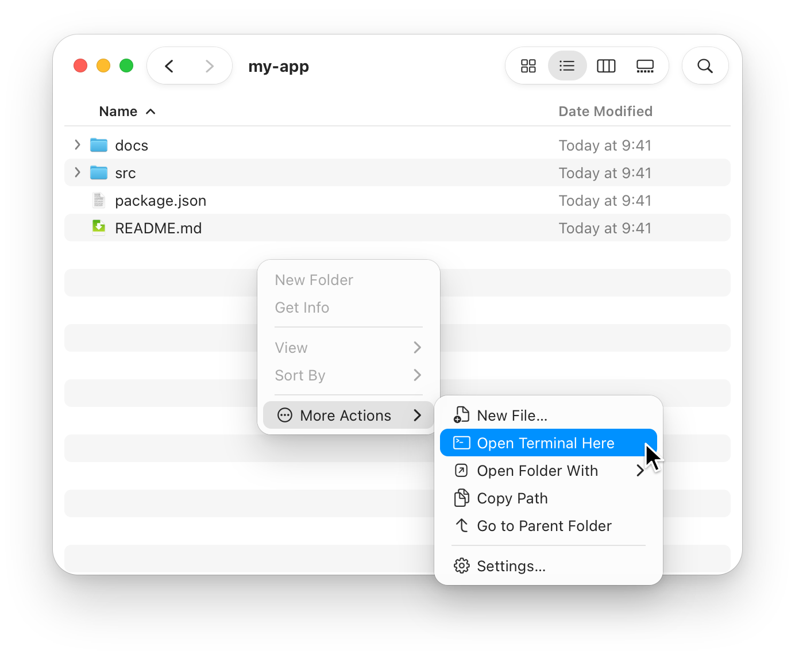
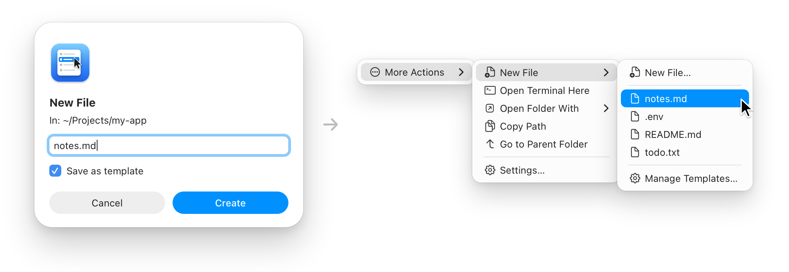
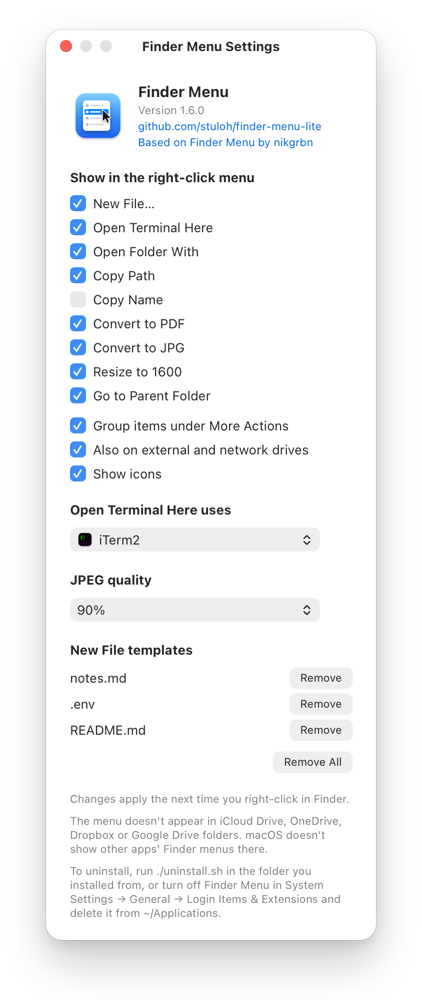

<p align="center">
  
</p>

<h1 align="center">Finder Menu</h1>

<p align="center">
  <b>The right-click options macOS is missing.</b><br>
  New File, Open Terminal Here, Open Folder With, Copy Path, Go to Parent Folder, and quick conversions to PDF, JPG and 1600px, in Finder's own menu.
</p>

<p align="center">
  <sub>A fork of <a href="https://github.com/nikgrbn/finder-menu">Finder Menu</a> by <a href="https://github.com/nikgrbn">nikgrbn</a>, adding file conversions and a More Actions submenu.</sub>
</p>

<p align="center">
  
  
  
  <a href="#privacy--security"></a>
  <a href="LICENSE"></a>
</p>

<p align="center">
  <a href="#install">Install</a> ·
  <a href="#whats-in-the-menu">What's in the menu</a> ·
  <a href="#new-file-templates">Templates</a> ·
  <a href="#settings">Settings</a> ·
  <a href="#languages">Languages</a> ·
  <a href="#privacy--security">Privacy</a> ·
  <a href="#how-it-works">How it works</a>
</p>

<br>

<p align="center">
  <picture>
    <source media="(prefers-color-scheme: dark)" srcset="docs/images/menu-dark.png">
    
  </picture>
  <br>
  <sub>Right-click empty space in any folder. Finder's own items are faded here to show what Finder Menu adds.</sub>
</p>

<br>

<table>
  <tr>
    <td align="center" valign="top" width="25%"><h3>📂</h3><b>Built-in</b><br>Nine actions under one item in Finder's own right-click menu.<br><br></td>
    <td align="center" valign="top" width="25%"><h3>🧰</h3><b>Your tools</b><br>Terminals, VS Code, Cursor, JetBrains, Xcode, Word…<br><br></td>
    <td align="center" valign="top" width="25%"><h3>🔒</h3><b>Private</b><br>No network code, no telemetry.<br><br></td>
    <td align="center" valign="top" width="25%"><h3>🪶</h3><b>Small</b><br>About 1,400 lines of Swift, built on your Mac.<br><br></td>
  </tr>
</table>

## What's in the menu

Right-click in any folder and open **More&nbsp;Actions&nbsp;▸**. Keeping everything under one item keeps Finder's menu short. **Settings…** sits at the bottom of the submenu. To show the items side by side in Finder's menu instead, untick **Group items under More Actions** in [settings](#settings).

| &nbsp;&nbsp;&nbsp;&nbsp;&nbsp;&nbsp; | Menu item | What it does |
|:-:|---|---|
| <picture><source media="(prefers-color-scheme: dark)" srcset="docs/icons/new-file-dark.png"></picture> | **New&nbsp;File…** | Asks for a name with any extension (`notes.md`, `main.py`, `.env`), creates it in the current folder and selects it. Never overwrites. Names you use often can be [saved as templates](#new-file-templates). |
| <picture><source media="(prefers-color-scheme: dark)" srcset="docs/icons/terminal-dark.png"></picture> | **Open&nbsp;Terminal&nbsp;Here** | Opens a terminal in the current folder: iTerm2, Ghostty, Warp, WezTerm, kitty or Alacritty if you have one, otherwise Terminal. [Pick your own](#settings). |
| <picture><source media="(prefers-color-scheme: dark)" srcset="docs/icons/open-with-dark.png"></picture> | **Open&nbsp;Folder&nbsp;With&nbsp;▸** | Opens the current folder in an IDE or editor. Lists the ones you have installed (VS Code, Cursor, Windsurf, Zed, Sublime Text, JetBrains IDEs, Android Studio, Xcode…), plus **Other App…** to pick any app. |
| <picture><source media="(prefers-color-scheme: dark)" srcset="docs/icons/copy-path-dark.png"></picture> | **Copy&nbsp;Path** | Copies the current folder's full path. |
| <picture><source media="(prefers-color-scheme: dark)" srcset="docs/icons/copy-name-dark.png"></picture> | **Copy&nbsp;Name** | Copies the current folder's name, like `my-project`. Off until you turn it on in [settings](#settings). |
| <picture><source media="(prefers-color-scheme: dark)" srcset="docs/icons/to-pdf-dark.png"></picture> | **Convert&nbsp;to&nbsp;PDF** | Right-click Word documents (`.docx`, `.doc`) to save a PDF next to each, like `report.pdf`. Microsoft Word does the converting, so it needs Word installed. A document you already have open stays open. |
| <picture><source media="(prefers-color-scheme: dark)" srcset="docs/icons/to-jpg-dark.png"></picture> | **Convert&nbsp;to&nbsp;JPG** | Right-click PNG, HEIC, TIFF, GIF, BMP, WebP or AVIF images to save a JPEG copy of each, like `photo.jpg`. Transparent areas become white. The quality is 90% unless you change it in [settings](#settings). |
| <picture><source media="(prefers-color-scheme: dark)" srcset="docs/icons/resize-dark.png"></picture> | **Resize&nbsp;to&nbsp;1600** | Right-click images (JPEG too) to save a copy whose longest side is 1600 pixels, like `photo 1600px.png`, in the same format. Images already that small are skipped. |
| <picture><source media="(prefers-color-scheme: dark)" srcset="docs/icons/parent-folder-dark.png"></picture> | **Go&nbsp;to&nbsp;Parent&nbsp;Folder** | Moves the window up one level, even when Finder's Back button is greyed out (e.g. a window opened with `open .`). |

The three conversions only appear when every selected file is one they handle. They always make a new file next to the original, never change or overwrite anything, and use the next free name if one is taken (`photo 2.jpg`). Finder selects the new files when they're done, except on the Desktop, where they're already in view.

Right-clicking a file or folder works too: **Copy Path** and **Copy Name** copy the selected items' paths or names (file names with their extensions), and **Open Terminal Here** and **Open Folder With** use the selected folder.

The menu also appears on external drives, disk images and network shares (such as SMB), not just your Mac's own disk. It doesn't appear in iCloud Drive, OneDrive, Dropbox or Google Drive folders (see [Troubleshooting](#troubleshooting)).

On macOS 26 and later the items have icons, like Finder's own. On earlier versions Finder's items have none, so Finder Menu's don't either. The same goes for other apps' Open and Save dialogs, which show the menu too: their own items have no icons. You can turn them on or off with **Show icons** in [settings](#settings).

## New File templates

<p align="center">
  <picture>
    <source media="(prefers-color-scheme: dark)" srcset="docs/images/templates-dark.png">
    
  </picture>
</p>

1. Tick **Save as template** in the New File dialog.
2. Next time, pick it under **More Actions ▸ New File** to create an empty `notes.md` in one click.

If the name is taken, you get `notes 2.md`, like in Finder. **Manage Templates…** removes templates.

## Install

```bash
git clone https://github.com/stuloh/finder-menu-lite.git
cd finder-menu-lite
./install.sh
```

The app is built on your machine, installed to `~/Applications/Finder Menu.app` and the Finder extension is turned on. There's nothing to launch: Finder loads the extension by itself, including after a restart. You need the Xcode Command Line Tools (`xcode-select --install`).

> [!NOTE]
> Some actions ask for permission the first time you use them. **Go to Parent Folder** asks whether Finder Menu can control Finder, which is how it moves the window. **Convert to PDF** asks the same about Microsoft Word. Click **OK** for both.

> [!IMPORTANT]
> The original Finder Menu's Homebrew tap (`nikgrbn/tap/finder-menu`) installs the original app, without this fork's changes. Install from this repo instead. Both use the same app name and settings, so install only one.

### Update

Run this in the repo folder:

```bash
git pull && ./install.sh
```

## Settings

To open the settings window, do any of these:

- choose **More Actions ▸ Settings…** in the right-click menu;
- open **Finder Menu** from Spotlight or your Applications folder;
- run `scripts/finder-menu settings` in the repo folder.

The settings window lets you:

- choose which items appear in the right-click menu (**Copy Name** is off until you turn it on)
- choose whether the items sit under one **More Actions** item (they do by default) or side by side in Finder's menu
- choose whether the menu also appears on external and network drives (it does by default)
- turn the menu's icons on or off (by default they follow Finder: on in macOS 26 and later, off before)
- pick the terminal for **Open Terminal Here**. Automatic uses the first one installed, in this order: iTerm2, Ghostty, Warp, WezTerm, kitty, Alacritty, Terminal. **Other App…** lets you pick any app.
- pick the JPEG quality for **Convert to JPG** and **Resize to 1600** (60–100%, 90% by default)
- remove [New File templates](#new-file-templates)

It also shows:
- the version you have;
- links to this repo and to the original Finder Menu;
- a note about cloud folders;
- how to uninstall.

**About Finder Menu** in the app menu shows the same links.

<p align="center">
  <picture>
    <source media="(prefers-color-scheme: dark)" srcset="docs/images/settings-dark.png">
    
  </picture>
</p>

Changes apply the next time you right-click. You can also set the terminal from the command line, in the repo folder:
- `scripts/finder-menu terminal Ghostty` sets it (any app name works);
- `scripts/finder-menu terminal` shows the current choice;
- `scripts/finder-menu terminal auto` goes back to automatic.

## Languages

Finder Menu uses your Mac's language, or English if it isn't one of these:

<table align="center">
  <tr>
    <td align="center" valign="top" width="160">🇺🇸 <b>English</b></td>
    <td align="center" valign="top" width="160">🇨🇳 <b>简体中文</b><br><sub>by <a href="https://github.com/yunyv">@yunyv</a></sub></td>
    <td align="center" valign="top" width="160">🇫🇷 <b>Français</b><br><sub>by <a href="https://github.com/GullmeVrn">@GullmeVrn</a></sub></td>
    <td align="center" valign="top" width="160">🇩🇪 <b>Deutsch</b><br><sub>by <a href="https://github.com/9trzj5nztr-design">@9trzj5nztr-design</a></sub></td>
  </tr>
  <tr>
    <td align="center" valign="top">🇮🇹 <b>Italiano</b></td>
    <td align="center" valign="top">🇮🇷 <b>فارسی</b><br><sub>by <a href="https://github.com/aliafshany">@aliafshany</a></sub></td>
    <td align="center" valign="top">🇷🇺 <b>Русский</b></td>
    <td align="center" valign="top">🇪🇸 <b>Español</b><br><sub>by <a href="https://github.com/LuigimonSoft">@LuigimonSoft</a></sub></td>
  </tr>
  <tr>
    <td align="center" valign="top">🇺🇦 <b>Українська</b><br><sub>by <a href="https://github.com/artemartemenko">@artemartemenko</a></sub></td>
    <td align="center" valign="top">➕ <a href="#contributing"><b>Add yours</b></a></td>
  </tr>
</table>

These translations were contributed to the original Finder Menu. The text this fork added is translated too, but no native speaker has checked it yet. Corrections are welcome.

## Uninstall

In the repo folder:

```bash
./uninstall.sh
```

This turns the Finder extension off and removes `~/Applications/Finder Menu.app`.

Without the repo folder, uninstall it by hand:
1. Turn off **Finder Menu** under System Settings → General → Login Items & Extensions → Finder extensions.
2. Delete **Finder Menu** from `~/Applications`.

The settings window shows these steps too.

## Troubleshooting

- **Menu items don't appear:** hold ⌥, right-click Finder in the Dock and choose **Relaunch**. Also check that **Finder Menu** is turned on under System Settings → General → Login Items & Extensions → Finder extensions.
- **Menu items don't appear in OneDrive, Dropbox, Google Drive or iCloud Drive folders:** a macOS limitation.
  - These apps sync through Apple's File Provider, and Finder doesn't show other apps' Finder extension menus in their folders, so other right-click menu apps are missing there too.
  - This includes Desktop and Documents if they sync to iCloud. Use a local folder, such as Downloads.
  - [Issue #29 in the original project](https://github.com/nikgrbn/finder-menu/issues/29) has the details.
- **Word asks to Grant File Access when converting to PDF:** Word is sandboxed, so it asks before saving into a folder for the first time, and remembers each folder you grant. Choose your home folder in that dialog and it won't ask again for anything inside it.
- **Asked for permission again after reinstalling:** expected. Every build is signed locally with a new signature, so macOS asks again.
- **A drive shows the Finder Menu icon in Finder's sidebar:** expected.
  - Finder gives every drive a Finder extension works on that app's icon, except the startup disk, so the menu can't appear on a drive without it. It's only the icon.
  - If it bothers you, untick **Also on external and network drives** in [settings](#settings), which also takes the menu off those drives.
  - [Issue #14 in the original project](https://github.com/nikgrbn/finder-menu/issues/14) has the details.

## How it works

- `Sources/FinderMenuExtension` is a [Finder Sync extension](https://developer.apple.com/documentation/findersync) that adds the menu items to every folder.
  - Finder only asks it about the drives it lists, so it lists every mounted drive and updates the list when one is mounted or ejected.
  - It puts the items under More Actions unless that's turned off.
  - Finder extensions must run sandboxed, so this part only reads the clicked folder and the selected items' names, and copies paths and names.
- `Sources/FinderMenu` is a small helper app that isn't sandboxed and has no Dock icon.
  - The extension hands it actions through a `findermenu://` URL, and the helper ignores those URLs from anything else.
  - It creates the files, opens the terminal, moves the Finder window and runs the conversions, then quits.
- **Conversions:** `topdf`, `tojpg` and `resize` links carry the selected files' paths. The helper checks each one again: it must exist, not be a folder, and have an extension the action accepts (`Sources/Shared/Documents.swift`).
  - Convert to PDF scripts Microsoft Word (`wordToPDFScript` in `Sources/FinderMenu/Paths.swift`).
  - The image actions use macOS's ImageIO (`Sources/FinderMenu/Images.swift`).
- `Sources/Shared/Settings.swift` holds the list of menu items and reads the settings; `Sources/FinderMenu/SettingsWindow.swift` is the settings window. The helper writes the settings, and the extension only reads them.
- `Sources/Shared/Templates.swift` holds the New File templates (saved file names). The extension builds the New File submenu from them, and the helper looks up the chosen template by id, so the file name never travels in the URL.
- `Sources/Shared/Editors.swift` is the IDE list. The extension builds the submenu from it, and the helper refuses links naming any app that isn't on it.
- `scripts/build.sh` compiles and signs the app; `scripts/finder-menu enable|disable` copies it into `~/Applications` and turns the extension on or off. `install.sh` and `uninstall.sh` use these two.
- `Resources/*.lproj` holds the translations, one folder per language. `scripts/build.sh` copies them into both the helper and the extension, because the extension shows the menu titles.
- `Tests` checks:
  - the helper's path handling and AppleScript escaping;
  - the terminal launch arguments;
  - the conversions' file checks and output names, plus real image conversions and resizes;
  - the translations.
- `scripts/test.sh` builds and runs the tests, and CI runs them and a full build on every pull request (if GitHub Actions is turned on for the repo).
- `scripts/make-icon.swift` draws the app icon in code and regenerates `Resources/AppIcon.icns` and `docs/icon.png`.
- `docs/mockups/mockups.html` draws the pictures in this README with HTML and CSS, and `scripts/make-mockups.swift` renders them to `docs/images` in light and dark.

## Privacy & security

You build Finder Menu yourself from this source, so there's no downloaded app to trust. Everything below can be checked in the code:

- **No network access.** There's no networking code, so nothing is sent anywhere: no telemetry, no analytics, no update checks.
- **Small enough to read.** About 1,400 lines of Swift and 185 lines of shell scripts (`install.sh`, `uninstall.sh` and `scripts/`). Read them before you run them.
- **Sandboxed Finder extension.** It can't read your files. It only gets:
  - the folder you right-click and the items you select;
  - the list of mounted drives;
  - which app owns the window under the pointer, to tell Finder from an Open or Save dialog (never a window's title or contents);
  - read-only access to Finder Menu's own settings: which items to show, where, and with or without icons, plus any New File templates.
- **The helper only acts when you pick a menu item.** It does one of these, and never overwrites anything:
  - creates an empty file with the name you type or a template name you saved;
  - opens a terminal or an app in a folder;
  - moves the Finder window up a level;
  - has Word save the Word documents you selected as PDFs next to them;
  - saves JPEG and resized copies of the images you selected, converted on your Mac with macOS's own ImageIO.
- **Links from other apps are ignored.** The extension sends actions to the helper as `findermenu://` links. Other apps can send those links too, and so can a website after your browser asks you. Opening a folder they choose in a terminal or IDE could run code from it, so the helper checks the code signature of whatever sent each link and ignores any that didn't come from its own Finder extension. On top of that, the helper:
  - only acts on folders and files that exist;
  - only converts files with an extension the action accepts;
  - only opens apps from its built-in IDE list, or one you pick yourself;
  - asks before a custom New File;
  - for templates, only uses a file name you already saved, never one taken from the URL.
- **Two permissions.** Go to Parent Folder asks once to control Finder, and Convert to PDF asks once to control Microsoft Word. Finder Menu doesn't ask for Full Disk Access, Accessibility or anything else.
- **Signed locally, not notarized.** `install.sh` signs the build on your Mac ("Sign to Run Locally"). It isn't notarized by Apple, because there's no download for Apple to check.

Found a security problem? Please report it privately, as described in [SECURITY.md](SECURITY.md).

## Contributing

Bug reports and pull requests are welcome. Run `scripts/test.sh` before opening one.

- **Translations:** copy `Resources/en.lproj` to `Resources/<code>.lproj`, translate the text in it, add the code to `CFBundleLocalizations` in both `Resources/*-Info.plist` files, and open a pull request. `scripts/test.sh` tells you if a key, a `%@` or the language code is missing.
- **README pictures:** they're mockups, not screenshots. Edit `docs/mockups/mockups.html`, then run `swift scripts/make-mockups.swift`.

## Credits

Finder Menu was created by [nikgrbn](https://github.com/nikgrbn) at [github.com/nikgrbn/finder-menu](https://github.com/nikgrbn/finder-menu). It provides everything except the conversions, the More Actions submenu and the JPEG quality setting. The translators are credited under [Languages](#languages). Thank you!

## License

[MIT](LICENSE). The original copyright is kept, alongside this fork's.
